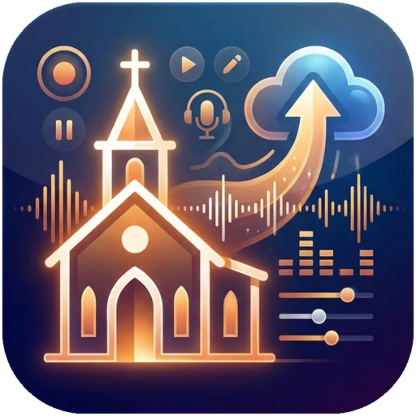

<p align="center">
  
</p>

<h1 align="center">Sermon Studio</h1>

<p align="center"><i>Turn a Sunday service recording into a published sermon podcast, with a local AI and on your own hardware.</i></p>

A self-hosted web app that turns a full Sunday service recording into a sermon podcast episode. It works as a four-step wizard:

1. **Upload:** drop in the service recording and the sermon slide (cover image). You can also pick files already on the NAS.
2. **Analyze:** when you leave step 1, a dialog suggests a NAS folder (following your existing folder layout) and asks, with a switch per file, whether to copy the recording, the slide and the finished MP3 there. Then Whisper transcribes the service locally and a local LLM finds where the sermon starts and ends, then writes a title, the scripture reference and a 2–3 sentence description.
3. **Review:** check the cut on a waveform with a clickable, searchable transcript. Then edit the title, speaker, date, scripture, description and **series**. Series and speaker come from WordPress and default to those of the most recently edited sermon.
4. **Publish:** the app encodes a small mono MP3 (volume-levelled, ID3-tagged, cover art embedded) and saves it next to the recording on the NAS. It shows a preview of the post, then uploads it to WordPress as a draft or publishes it.

It can also run **hands-off**: it watches the NAS archive for new service recordings, analyzes them on its own and sends the result to you on **Discord**, listing the lines where the sermon might start and end so you can correct it with one tap. You reply with the week's slide and press **Publish** (see [Automation](#automation-new-recordings--discord)).

Everything except the WordPress upload and Discord runs on your own hardware. No audio leaves the house until you press upload.

Built for a church website hosted on The Church Co's WordPress platform. The upload step is written for their podcast form, and everything else is generic.

---

## How it works

```
 browser ──► sermon-studio (FastAPI, :8790) ──► ffmpeg        (convert, waveform, encode)
                    │                      ──► faster-whisper (speech-to-text, CPU or CUDA)
                    │                      ──► ollama         (local LLM: sermon boundaries, title)
                    └──────────────────────────► WordPress wp-admin (login → upload media → fill in the podcast form)
```

| Stage | What happens | Output (in `data/work/<job-id>/`) |
|---|---|---|
| Upload | The browser uploads both files into `data/uploads/`, keeping the recording's original timestamp so re-uploading the same file reuses its analysis | `data/uploads/` |
| Archive | When you leave step 1, a **Save to the NAS?** dialog suggests `<recordings folder>/YYYY/MM - Month/YYYY_MM_DD`. It copies the naming of existing folders, reuses a folder that already exists for that date, and looks one level down if the year folders are in a subfolder. There's a switch for each file: recording, slide (`<prefix>YYYYMMDD.jpg`) and finished MP3. Files already in the folder default to off. Copies never overwrite a file the app didn't write itself. | NAS |
| Prepare | ffmpeg makes a 16 kHz mono WAV for Whisper, a 48 kbps preview MP3 for the browser player and a waveform PNG | `speech.wav`, `preview.mp3`, `waveform.png` |
| Transcribe | faster-whisper with VAD; `small.en` on CPU, `large-v3-turbo` on GPU | `transcript.json` |
| Detect | **By voice** (see below): voiceprints of every ~3 s of speech find the preacher's continuous talk; the local AI then picks the exact first/last line around each edge. **Fallbacks:** AI-only on the transcript, then the longest stretch of steady speech. | `voice.npz`, `proposal.json` |
| Who preached | The sermon's voice is compared with profiles learned from sermons you've published; if that's not a clear match the AI looks for clues in the transcript; otherwise last week's speaker (flagged in Review and Discord). | `data/voices.json` |
| Suggest | Title, main scripture and a 2–3 sentence description from the sermon text (LLM, plus a regex scripture finder). "✨ Write it again" in Review re-runs it for an adjusted cut. | stored in `state.json` |
| Encode | Cut, 70 Hz high-pass, loudness-normalised to −16 LUFS (the podcast standard), fades, mono MP3 at the chosen bitrate, ID3 tags and cover | `data/output/<FILE_PREFIX>YYYYMMDD.mp3` |
| Upload | Logs in to wp-admin, uploads the MP3 and cover to the media library and submits the "Add New Podcast" form the same way a person would | link shown in the UI |

Transcripts are cached per recording, so reopening a job is instant and "re-run detection" doesn't re-transcribe.

### Finding the sermon by voice

The preacher is the one person who talks continuously for 30+ minutes. Sermon Studio uses that:

1. Speech is cut into ~3-second windows and each gets a **voiceprint** from a small speaker-recognition model (CAM++ trained on VoxCeleb, run locally with [sherpa-onnx](https://github.com/k2-fsa/sherpa-onnx); downloaded on first use, ~30 MB).
2. The longest stretch of continuous speech is the sermon's core; the preacher's voice is learned from its middle.
3. **Every transcript line near that region is a candidate start or end,** scored on several clues at once (`app/edges.py`):
   * **Start:**
     * the next 10 minutes are mostly the preacher (a scripture reading or prayer by someone with a similar voice lasts a few minutes; a sermon keeps going)
     * the voice switches to the preacher here
     * it's the *last* greeting / "open your Bibles" before he keeps talking (the reader greets first)
     * an "amen" right before it (the children's prayer ends)
     * a long pause before it (e.g. after a video)
     * penalties: someone announcing a scripture reading ("we're going to read…"), or being far from the voice estimate
   * **End:**
     * the closing prayer's "amen", including one in the middle of a transcript line
     * **a song starting**: the next 3 minutes repeat themselves (choruses), the previous 3 didn't
     * the voice stopping
     * a penalty for being far from the voice estimate
4. **Where the sermon ends** is a setting (⚙ Settings → Default preacher card): after the closing prayer's "amen" (default) or at "Let's pray".

**How accurate it is.** The weights were tuned on **104 past services with hand-made cuts**. A comparison batch ran every recording through the app, and each hand-made MP3 was located in its recording by audio cross-correlation. Accuracy is from 5-fold cross-validation, i.e. measured on services the tuning didn't see:

| | Within 10 s | Within 30 s | Within 60 s | Off by > 5 min | Median |
|---|---|---|---|---|---|
| Start, previous method (greeting / AI) | 35% | 66% | 78% | 14 | 15 s |
| **Start, now** | **61%** | **84%** | **91%** | **1** | **4 s** |
| End, previous method | 67% | 76% | 81% | 5 | 1 s |
| **End, now** | **92%** | **94%** | **94%** | **2** | **1 s** |

Ends are judged on the 63 hand cuts that end after the closing prayer, the current house style. Older cuts that stopped at "Let's pray" are left out.

**Re-tuning as you go.** After a batch over past recordings with hand-made MP3s (all options off), run `docker exec -w /srv sermon-studio python -m app.tune_edges`. It reports current vs re-tuned accuracy on held-out services, and `--save` writes `data/edge_weights.json`, which the app then uses.

### Recognizing who preached

The day's sermon voice is compared with **profiles learned from the raw recordings of sermons you publish**: each publish (or draft) adds that preacher's voice. Every recording shares a lot (same room, PA and microphones), so voices are compared after subtracting the average of all analyzed services. The published MP3s aren't used: they were processed differently over the years, which hides the difference between voices.

* Clear voice match → the name is filled in ("🎙 Recognized by voice").
* Otherwise, if you've chosen a **default preacher** (⚙ Settings → Default preacher, picked from your WordPress *People*), that name is used → "👤 Default preacher… please check it".
* Otherwise the local AI looks for clues in what was said ("as John read…", being introduced, the preacher naming himself) → "📝 From the transcript".
* Otherwise last week's speaker is used, and the Review step and Discord both say to check it.

The name goes into the MP3's ID3 tags and the WordPress *People* field. New preachers are learned the first time you publish one of their sermons.

---

## Requirements

- Docker with Compose v2
- About 10 GB of disk for images and models (the Whisper model and `qwen2.5:7b-instruct` download on first use)
- **CPU-only works**, it's just slower. On an i5-10500, a 65-minute service takes roughly 10–15 minutes to transcribe, and the LLM detection takes a few minutes more.
- **NVIDIA GPU (recommended):** takes a whole service from about 20 minutes down to about 1–2 minutes. Needs the NVIDIA driver and the [NVIDIA Container Toolkit](https://docs.nvidia.com/datacenter/cloud-native/container-toolkit/install-guide.html). About 8 GB of VRAM fits both Whisper `large-v3-turbo` and a 7B LLM.

## Install

> **New here?** Follow the step-by-step guide with screenshots: **[docs/SETUP.md](docs/SETUP.md)**.

```bash
git clone https://github.com/<your-user>/sermon-studio.git ~/Docker/sermon-studio
cd ~/Docker/sermon-studio
cp .env.example .env        # then edit it (see below)
mkdir -p data ollama
docker compose up -d --build
```

Open **http://<server>:8790**. The first visit starts a **setup wizard** that walks you through:

1. **Storage:** pick the recordings folder.
2. **WordPress:** enter the login and test it.
3. **Discord:** create the bot (instructions included), then send a test message. Optional.
4. **Monitoring:** turn automatic watching on. Optional.

Everything can be changed later under **⚙ Settings**. Values saved there are stored in `data/settings.json`, which only the owner can read, and override the matching `.env` values. So the only `.env` settings you strictly need are the folder mounts (`NAS_PATH`, `LOCAL_PATH`, `BROWSE_ROOTS`).

### Paths

`docker-compose.yml` mounts:

| Host | Container | Shown in the browser as |
|---|---|---|
| `NAS_PATH` (e.g. a NAS share, **writable** so recordings and MP3s can be archived) | `/media/nas` | `NAS` |
| `LOCAL_PATH` (read-only) | `/media/local` | `Local` |
| `./data/uploads` | `/data/uploads` | `Uploads` (files uploaded from your computer) |

Set `NAS_PATH` and `LOCAL_PATH` in `.env` (Compose reads them from there), and keep `BROWSE_ROOTS` in step with the container paths. The file browser can't leave these folders. The container runs as UID 1000, so the mounted folders must be readable by that user.

### Turning on the GPU (once the card is installed)

```bash
# install the NVIDIA driver + nvidia-container-toolkit, then:
sudo nvidia-ctk runtime configure --runtime=docker && sudo systemctl restart docker
docker compose -f docker-compose.yml -f docker-compose.gpu.yml up -d
```

The header of the page shows which model and device are in use (for example `AI: large-v3-turbo on CUDA`). No rebuild is needed because the CUDA libraries are already in the image.

## Configuration (`.env`)

| Variable | Default | Meaning |
|---|---|---|
| `WP_URL` | `https://www.example-church.org` | WordPress site |
| `WP_USER` / `WP_PASSWORD` | — | A WordPress login that can create podcasts and upload media (no 2FA). Set them with the snippet below so the password stays out of your shell history. |
| `WP_POST_TYPE` | `podcasts` | Post type for sermons |
| `WP_ALWAYS_CATEGORY` | `All Sermons` | Category ticked on every sermon in addition to its series |
| `WP_DEFAULT_STATUS` | `draft` | Reserved for the default upload status (the UI has both buttons) |
| `WHISPER_MODEL` | `auto` | `auto` = `large-v3-turbo` on GPU, `small.en` on CPU. Any faster-whisper model name works. |
| `LLM_MODEL` | `qwen2.5:7b-instruct` | Ollama model for detection and titles. Leave it blank to use the speech-rate heuristic only. |
| `MP3_BITRATE` | `64k` | Default bitrate (can be changed per sermon in the UI) |
| `FILE_PREFIX` | `Sermon_` | Output name: `<prefix>YYYYMMDD.mp3` |
| `NAS_PATH` / `LOCAL_PATH` | `/mnt/nas`, `/srv/recordings` | Host folders mounted read-only for the file browser |
| `BROWSE_ROOTS` | `NAS=/media/nas,Local=/media/local,Uploads=/data/uploads` | Named folders the file browser can open |
| `START_PATH` | `NAS` | Folder the NAS picker opens at |
| `ARCHIVE_ROOT` | `NAS` | Archive folder for recordings and MP3s; the app suggests `YYYY/MM - Month/YYYY_MM_DD` under it |
| `GUIDE_EXAMPLES_PATH` | — | Folder (e.g. `NAS/Documents/Life Group`) with some of your own past discussion guides (`.docx`, `.md`, `.txt`). The newest two are given to the AI as examples of your format and tone. Blank = a generic built-in format. Also in Settings. |
| `GUIDE_DISCORD` | `false` | When a sermon is published (not in a batch), also write its Life Group guide and post the Word file on Discord. Also in Settings. |

To set the login without the password landing in your shell history, save this as `set-wp-login.sh` and run `bash set-wp-login.sh`. Run it as a file rather than pasting it, because a pasted `read` takes the next pasted line as its answer:

```bash
#!/bin/bash
cd ~/Docker/sermon-studio || exit 1
read -p "WordPress username: " WPU
read -s -p "WordPress password: " WPP; echo
WPU="$WPU" WPP="$WPP" python3 - <<'EOF'
import os, re, sys
user, pw = os.environ["WPU"], os.environ["WPP"]
if "'" in pw:
    sys.exit("Passwords containing ' can't be stored in .env; please pick another one.")
s = open(".env").read()
s = re.sub(r"^WP_USER=.*$", lambda m: f"WP_USER={user}", s, flags=re.M)
s = re.sub(r"^WP_PASSWORD=.*$", lambda m: f"WP_PASSWORD='{pw}'", s, flags=re.M)
open(".env", "w").write(s)
EOF
chmod 600 .env
docker compose up -d --force-recreate sermon-studio
```

`.env` holds your WordPress password. It's in `.gitignore`, so never commit it.

### About the WordPress login

The Church Co blocks the WordPress REST API for everyone, logged in or not: every route answers `{"message":"God Bless"}`. So Sermon Studio does what you would do by hand. It logs in at `wp-login.php` and fills in **Podcasts → Add New** (`post-new.php?post_type=podcasts`):

| Form field | Filled with |
|---|---|
| Title | sermon title |
| Content | the 2–3 sentence description |
| Excerpt | scripture reference (e.g. `Romans 8:28-39`) |
| Audio (ACF file field `podcast_audio`) | the MP3, uploaded to the media library |
| Featured image | the cover image |
| Feed Image (ACF `podcast_feed_image`) | copied from the most recent sermon (the same podcast artwork every week) |
| People | the speaker; the UI suggests names from the People list |
| Categories | **All Sermons** plus the chosen series |
| Publish date | the service date, 10:00 |

ACF fields are looked up by name, so it keeps working if the field keys change. If the login fails with "no session cookie", the account probably has 2FA or the login page has a captcha.

**Default series and speaker:** WordPress doesn't record when a category was edited, so the app opens the most recently modified sermon post and uses its series (any category other than "All Sermons") and its speaker.

`GET /api/wp/discover` dumps the podcast form's fields, ACF fields and categories, which helps if The Church Co changes the form.

## Using it

The step bar at the top shows where you are. Click any finished step to go back to it.

1. **Upload.** Drop the WAV into the left box and the sermon slide into the right box, or tap a box to choose a file. Each box shows upload progress and turns green when the file is done. **Next: Analyze** starts the work. If you leave out the image, the app asks before continuing, and you can add one in Review.
2. **Analyze.** Clicking **Next** first opens **Save to the NAS?**. Check the suggested folder (or **Change…** it) and switch each file on or off. Files already in that folder start switched off. **Don't save to the NAS** keeps everything in Sermon Studio's cache only. Step 2 itself only shows the analysis. The checklist shows each stage: convert, transcribe (with %), find the sermon, write the title and description. On a CPU this takes about 20–25 minutes for a 65-minute service, and with a GPU a couple of minutes. You can close the tab and come back later via **Continue a sermon you already started** in step 1. Each entry there has a **🗑 Delete** button. It removes the sermon's analysis, previews, MP3 and uploaded files from the app, but not anything on the NAS or in WordPress. Tick **🔔 Notify me on Discord when it's done** to get the same Discord message as for automatically found recordings, with the start/end choices and Publish/Draft buttons.
3. **Review.**
   - The shaded part of the waveform is the sermon. Click the waveform to listen anywhere. **▶ Listen** and **▶ Last 10 s** play the edges.
   - Hover a transcript line and press **start here** or **end here**, type a time (`H:MM:SS`), or play to a point and press **Set to playhead**. Search finds phrases like "let's pray".
   - Edit the title, speaker, date, series, scripture (excerpt) and description (content). **✨ Write it again** asks the AI for a new title, scripture and description based on your adjusted cut.
   - **MP3 settings** sets the bitrate (64 kbps mono by default) and loudness levelling.
4. **Publish.** The app makes the MP3 (with a live progress bar) and copies it, plus the sermon slide as `<prefix>YYYYMMDD.jpg`, into the NAS folder. It then shows the post as it will appear, with a player for the finished MP3. Choose **Upload as draft** to check the post in WP Admin first (recommended), or **Publish now**. After a draft, the buttons become **Update the draft** and **Publish the draft**: these change that same post and only upload the MP3 or slide again if they've changed. If you already published or deleted the draft in WP Admin, the app notices and doesn't make a duplicate. When it's done you get links to the post, and **Start the next sermon** starts over.

## Automation: new recordings → Discord

Monitoring can be switched on and off in the web app's **⚙ Settings** tab; that choice is remembered and overrides `WATCH_ENABLED` (which only sets the default). When you switch it back on, the app asks whether to also analyze recordings that arrived while it was off, or to skip them. The tab also shows when the NAS was last checked, has a **Check now** button, and shows whether Discord, WordPress and the AI are connected.

While monitoring is on, the app scans `ARCHIVE_ROOT` every `WATCH_INTERVAL` seconds for new `.wav` files.

- On the first scan it records everything already there and processes none of it, so only recordings that appear afterwards are picked up.
- A file counts as new once its size has stopped changing between two scans and it's at least 2 minutes old, so a recording that's still copying isn't analyzed half-finished.
- Files the app copies into the archive itself (from **Save here**) are ignored.
- The scan state is kept in `data/watch.json`. Delete that file to take a fresh baseline.

For each new recording, the Discord bot:

1. **Tells you it's analyzing** the recording, with the folder name and a time estimate.
2. **Sends the proposed sermon** once the analysis is done. The message shows the title, series, speaker, date, scripture, description and start → end times, plus **where it starts** and **where it ends**: the best five candidate lines for each edge, with their time and words. The one the analysis chose is marked ✅ and the alternatives are numbered `2`–`5`. If it got an edge wrong, pick another line from the **Start** or **End** dropdown under the message. The edge moves at once and the ✅ moves with it. It has buttons for **✅ Publish**, **📝 Save as draft** and **✏️ Open** (one per app address), which opens the Review step if you want to change anything else. (`POST /api/jobs/{id}/edge {side, option}` does the same from elsewhere.)
3. **Asks for this week's sermon slide.** Reply to the message with the image, or just post it in the channel. It becomes the post's cover, and the Publish and draft buttons unlock once it has arrived.

**The slide:** if there's an image in the same folder as the new recording, the bot uses it as that week's slide and says which file it picked, so you can reply with a different one if it's wrong. If there isn't one, the "analyzing" message asks you to reply with the slide straight away. A slide you send goes on the WordPress post, is embedded in the MP3 and is saved to the NAS folder as `<prefix>YYYYMMDD.jpg`.

**Addresses for the Open buttons:** set *This app's address at home* (an IP like `http://192.168.1.10:8790` works best) and, optionally, *Address when away*, e.g. your Tailscale name `http://server.your-tailnet.ts.net:8790`. Each gets its own button. Discord only accepts full addresses (with a dot), so a bare name like `http://server:8790` is shown as text instead.

While something is being analyzed, step 1 of the Sermons tab and the monitoring section in Settings both say what's in progress, so you don't start it again by hand.

Pressing **Publish** or **Save as draft** makes the MP3 (with the proposed cut and details, or your edits if you changed them in the web app), saves it next to the recording on the NAS and posts it. The bot replies with the link. Only the Discord user in `DISCORD_USER_ID` can press the buttons or send slides.

The series and speaker default to those of the last sermon post, the same as in the web app.

### Creating the Discord bot

1. **Create a server** (optional but tidy). In Discord, press **+** in the server list → **Create My Own** → **For me and my friends**, and name it, e.g. "Home Lab". Add a text channel such as `#sermon-studio`.
2. **Turn on Developer Mode** so you can copy IDs: **User Settings → Advanced → Developer Mode**.
3. **Create the application:** go to <https://discord.com/developers/applications> → **New Application**, and name it "Sermon Studio".
4. **Set up the bot:** open the **Bot** tab.
   - Press **Reset Token**, then copy the token. That's `DISCORD_TOKEN`; treat it like a password.
   - Turn **on** *Message Content Intent*, which the bot needs to see the slide image you post.
   - Turn **off** *Public Bot*, so only you can add it to servers.
5. **Invite it to your server:** open **OAuth2 → URL Generator**. Tick the scope `bot`, then the bot permissions *View Channels*, *Send Messages*, *Attach Files*, *Embed Links* and *Read Message History*. Open the generated URL and pick your server.
6. **Copy the IDs:**
   - Right-click your own name → **Copy User ID**. That's `DISCORD_USER_ID`.
   - Right-click the channel → **Copy Channel ID**. That's `DISCORD_CHANNEL_ID`. Leave it blank to get DMs instead.
7. **Enter them in the app:** paste the token and IDs into **⚙ Settings → Discord bot** (or the setup wizard) and press **Send a test message**. The bot reconnects right away, with no restart needed. Alternatively, set `DISCORD_TOKEN`, `DISCORD_USER_ID`, `DISCORD_CHANNEL_ID` and `PUBLIC_URL` in `.env`.

The log (`docker logs sermon-studio`) shows `discord: logged in as Sermon Studio#1234` when the bot is connected.

## Batch processing (⚡ Batch tab)

Re-run past service recordings (for example the whole archive once a GPU is installed), review what Sermon Studio found, then apply it in one go. Nothing on the NAS or WordPress changes until the last step.

1. **Choose recordings:** every WAV under the recordings folder, newest first. Each one is matched to its WordPress post, by the date in the post's MP3 file name or else the post date. You can see whether there's a hand-made MP3 next to it and whether it was processed before. Filter by date range or "has a post / not processed / no MP3", and search by title or speaker. The summary estimates the time (about 3–4 min per service on a GPU, about 17 on the CPU).
2. **Options:**
   * **Cut:** keep your hand-made cut where there's an MP3 (located exactly in the recording by cross-correlation), or use the AI's cut everywhere.
   * **Voices:** teach the voice profiles from approved results.
   * **NAS:** save MP3s and slides. If a hand-made MP3 is already there: keep it and save the new one as `(2).mp3`, rename it to `.original.mp3`, or skip.
   * **WordPress, all off by default:** fix the speaker, add a missing description, replace the audio, or create drafts for services with no post.
   * **While it runs:** order, a Discord summary, and freeing temporary space.

   The options you choose are remembered and pre-selected for the next batch.
3. **Processing:** one service at a time through the normal queue, so a new Sunday recording found by the watcher goes in between. It shows overall progress, an ETA, and pause, resume and stop. The batch keeps running with the page closed and picks up again after a restart.
4. **Review results:** each service shows your cut vs the AI's, the preacher (and how they were recognized) and flags: *speaker differs from WordPress*, *voice not recognized*, *start/end differs from your MP3 by more than 30 s*, *no post*, *your MP3 not found in the recording*. Click a row to fine-tune it in place: waveform with your cut dashed, players, start/end with ±5 s and voice-labeled transcript lines, and the details. **Open ↗** opens the full Review screen in a new tab. Approve rows one by one or with **Approve all that look good**.
5. **Apply:** a summary of every change (MP3s and slides to the NAS, speaker changes with the reason, descriptions, drafts, voices learned), then **Apply changes** or **Only save to the NAS**. While it runs, each service shows what's happening (making the MP3 with %, copying to the NAS, updating WordPress, learning the voice), then what was done. Once everything you approved is applied the Apply buttons disappear; failed services get a *Retry* button. In a batch the speaker is: recognized voice → the speaker WordPress already lists → default preacher.

Your hand-made MP3s double as an accuracy check: the review shows the typical difference between the AI's cut and yours. On a two-service test both starts matched to within a second and both ends within 2 s.

## Life Group discussion guides

The **📖 Life Group discussion guide** card at the bottom of the Review step writes a discussion guide for a small group that meets during the week to talk about the sermon: a header (title, passage, series, date), then 7–9 numbered questions in the order of the sermon (an easy opener, the passage and the preacher's main points, how it points to Jesus, application), each with lettered leader notes (the answer as the sermon gave it, with verse references). It uses the sermon's cut and the details on the Review form (title, speaker, scripture, series, date), so fix those first.

- **How:** two passes with the local LLM. First it reads the sermon transcript in ~2,000-word chunks and takes notes of the points, verses, stories, memorable lines and applications the preacher actually used. Then it writes the guide from those notes, which keeps it grounded in the sermon and inside a 7B model's context. **↻ Write it again** gives a different version (the previous one is kept as `guide.prev.json`).
- **Your format:** set **Settings → Life Group guides → Example guides folder** (or `GUIDE_EXAMPLES_PATH`) to a folder of guides you've written. The newest two (by the date at the start of the file name, else the file date) are read each time a guide is written and shown to the AI as examples of format, tone and length. Their content isn't copied, and the app never stores or uploads them. Without examples it uses a generic format.
- **Output:** a preview in the card, **⬇ Download Word file** (Times New Roman 12, numbered questions with the leader notes lettered in red underneath, easy to edit), and Markdown at `/api/jobs/{id}/guide.md`. Everything is saved in `data/guides/<job-id>/` and survives deleting the sermon from the app.
- **NAS / Discord:** **Save to the NAS folder** copies the Word file next to the sermon's recording and MP3 (never overwriting a file the app didn't write). **Send to Discord** posts it in the bot's channel. With **When a sermon is published, also write its guide and post it on Discord** switched on, that happens on its own after publishing.
- About a minute on a GPU. Always read it through before the group meets: it's a draft from an automatic transcript.

## API

| Method | Path | |
|---|---|---|
| GET | `/api/status` | models, device, roots, saved settings |
| GET | `/api/browse?path=NAS/Audio&kind=audio\|image` | list a folder |
| POST | `/api/upload/audio` | multipart `file` (+ `last_modified` ms) → `{virtual}` |
| POST | `/api/upload/image` | multipart `file` → `{virtual}` |
| POST | `/api/jobs` `{path, cover}` | start (or reopen) analysis of a recording, with an optional cover image path |
| GET / POST | `/api/jobs/{id}/archive` (`?folder=` · `{folder, recording, slide, mp3, skip}`) | suggested folder + which files are already there · choose what to copy |
| POST | `/api/jobs/{id}/describe` `{start,end}` | re-write the title, scripture and description for a cut |
| GET | `/api/jobs`, `/api/jobs/{id}`, `/api/jobs/{id}/transcript` | job state |
| GET | `/api/jobs/{id}/preview.mp3 \| waveform.png \| cover.jpg \| output.mp3` | files |
| DELETE | `/api/jobs/{id}` | delete a sermon and its cached/uploaded files (not NAS or WordPress) |
| POST | `/api/jobs/{id}/redetect` | re-run detection on the cached transcript |
| POST | `/api/jobs/{id}/cover` (multipart) or `/cover-path` `{path}` | set the cover image |
| POST | `/api/jobs/{id}/encode` `{start,end,title,speaker,series,series_name,scripture,description,date,bitrate,normalize}` | make the MP3 |
| POST | `/api/jobs/{id}/publish` `{status: draft\|publish}` | upload to WordPress |
| GET | `/api/wp/meta`, `/api/wp/discover` | series list and default; field discovery |
| GET | `/api/settings` | monitoring status, what's in progress, Discord/WordPress/AI connection status |
| GET / POST | `/api/batch` · `/api/batch/recordings` · `/api/batch/start` · `/api/batch/control` · `/api/batch/items/{i}` · `/api/batch/approve` · `/api/batch/plan` · `/api/batch/apply` | batch processing |
| GET | `/api/active` | sermons being analyzed, and automatic ones waiting for review |
| POST | `/api/jobs/{id}/discord` | re-send the "sermon is ready" Discord message |
| GET / POST | `/api/config` (`{values}`) | storage/WordPress/Discord settings (secrets are never returned) |
| POST | `/api/config/test/wordpress` · `/api/config/test/discord` | test the login · send a Discord test message |
| POST | `/api/jobs/{id}/notify` `{on}` | Discord message when this analysis is done |
| POST | `/api/settings/watch` `{enabled, catch_up}` · `/api/settings/watch/scan` | turn monitoring on/off · check the NAS now |
| GET / POST | `/api/jobs/{id}/guide` (POST body: `{title, speaker, scripture, series_name, date, start, end}`, all optional) | the Life Group guide (state, preview HTML/Markdown) · write it (again) in the background |
| GET | `/api/jobs/{id}/guide.docx` · `/api/jobs/{id}/guide.md` | the guide as a Word file · as Markdown |
| POST | `/api/jobs/{id}/guide/nas` · `/api/jobs/{id}/guide/discord` | copy the Word file to the sermon's NAS folder · post it on Discord |

## Project layout

```
app/
  main.py         FastAPI routes, safe path resolution, upload/archive/encode/publish
  archive.py      NAS folder suggestion + no-clobber copying
  jobs.py         job queue + per-recording state in data/work/<id>/
  audio.py        ffmpeg helpers: prepare, encode, ID3 tags
  transcribe.py   faster-whisper (auto CPU/CUDA)
  detect.py       sermon boundary detection (LLM + heuristic), title/scripture suggestion
  wordpress.py    wp-admin client: series/speaker sync, media upload, podcast form
  voice.py        voiceprints: find the sermon by the preacher's voice, recognize who preached
  edges.py        picks the exact first/last line of the sermon (tuned clue scoring)
  tune_edges.py   re-tunes edges.py on hand-made cuts from a batch
  batch.py        batch processing of past recordings (scan, run, review, apply)
  guide.py        Life Group discussion guide: notes from the transcript, questions, Word/Markdown output
  watcher.py      polls the archive for new recordings
  settings.py     settings changed from the UI (data/settings.json)
  discord_bot.py  Discord notifications, approval buttons, slide upload
  static/         four-step wizard UI (no build step, no external JS)
docker-compose.yml       app + ollama
docker-compose.gpu.yml   GPU override
```

## Known limitations / TODO

- No authentication on the web UI. It's meant for the LAN or Tailscale only. Don't expose port 8790 to the internet.
- One analysis runs at a time. Encoding and uploading run alongside it.
- A speaker name that isn't already in People is created as a new person when the post is saved, so watch for typos.
