<p align="center">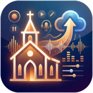</p>

# Setting up Sermon Studio

This guide takes you from nothing to a working Sermon Studio in about half an hour: installing the container, then the built-in **setup wizard** that opens the first time you visit the app.

You'll need:

| | |
|---|---|
| **A computer that's always on** | Any Linux machine, mini PC or home server that can run Docker. An NVIDIA GPU is optional but makes it about 10× faster. |
| **Your service recordings** | A folder of recordings, e.g. on a NAS, that the server can reach. WAV files from the sound desk work best. |
| **Your WordPress login** | For a site hosted by The Church Co. Use an account that can create podcast posts, without two-factor sign-in. |
| **Discord** (optional) | To be told when a sermon is ready and publish from your phone. |

---

## Part 1 · Install

### 1.1 Get the code

```bash
git clone https://github.com/admawby/sermon-studio.git ~/sermon-studio
cd ~/sermon-studio
cp .env.example .env
mkdir -p data ollama
```

### 1.2 Point it at your recordings

Open `.env` in a text editor and set the two folders on **this server** that Sermon Studio may use:

```bash
# where the service recordings are; the app saves finished MP3s next to them, so it needs write access
NAS_PATH=/mnt/nas
# optional, a second folder it can read from (e.g. a local drive)
LOCAL_PATH=/srv/recordings
```

Inside the app these show up as **NAS** and **Local**. If your recordings are on a NAS, mount the share on the server first (for example with an `/etc/fstab` CIFS or NFS entry) and use that mount point as `NAS_PATH`.

> The app runs as user ID 1000. Make sure that user can read the recordings, and write to `NAS_PATH` if you want MP3s saved there.

That's the only file editing you need to do. Everything else is set up in the browser.

### 1.3 Start it

```bash
docker compose up -d --build
```

The first build downloads Python, ffmpeg and the AI libraries (a few GB), so give it a few minutes. When it's done, open **http://&lt;your-server&gt;:8790** in a browser, e.g. `http://192.168.1.10:8790`.

**Have an NVIDIA GPU?** Install the NVIDIA driver and the [NVIDIA Container Toolkit](https://docs.nvidia.com/datacenter/cloud-native/container-toolkit/install-guide.html), then start it with the GPU override instead:

```bash
docker compose -f docker-compose.yml -f docker-compose.gpu.yml up -d --build
```

---

## Part 2 · The setup wizard

The first time you open the app, the setup wizard opens instead of the normal pages. The chips at the top show where you are; **← Back** always takes you to the previous step.

### Step 1 · Welcome

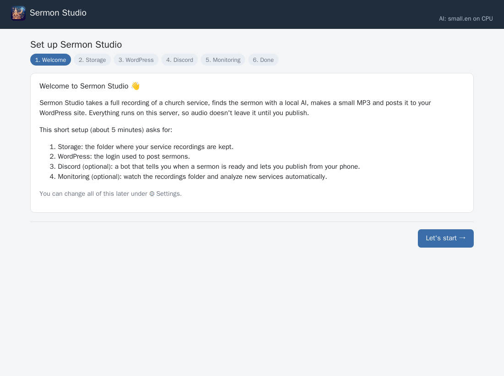

A short overview of what Sermon Studio does and what the wizard will ask for. Press **Let's start →**.

### Step 2 · Storage

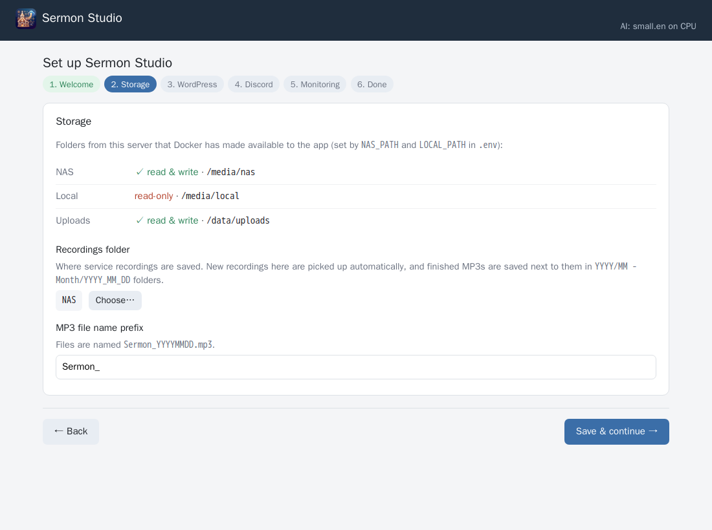

The top of the card lists the folders Docker has made available to the app, and whether it can write to them:

* **✓ read & write:** good. The app can save MP3s and slides there.
* **read-only:** fine for a folder you only pick recordings from.
* **✗ missing** or **empty: is the host folder mounted?:** the path in `.env` is wrong, or the NAS share isn't mounted on the server. Fix it, run `docker compose up -d` again, and reload the page.

**Recordings folder:** press **Choose…** and click your way to the folder where your service recordings are kept:

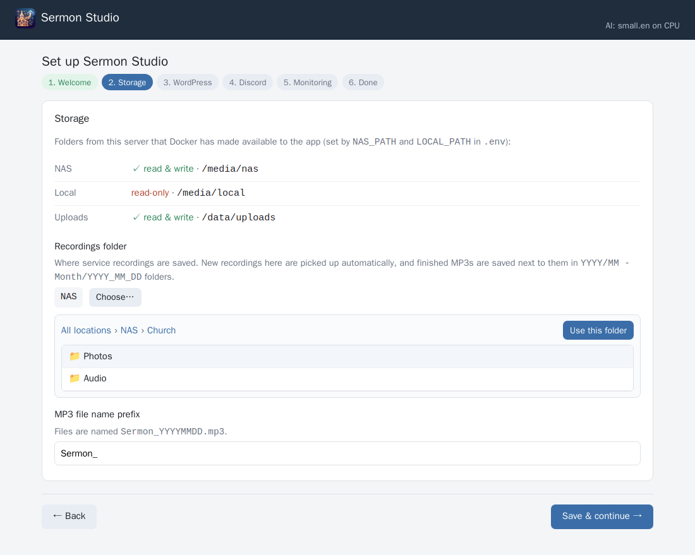

Open the folder (here `Church`, then `Audio`) and press **Use this folder**:

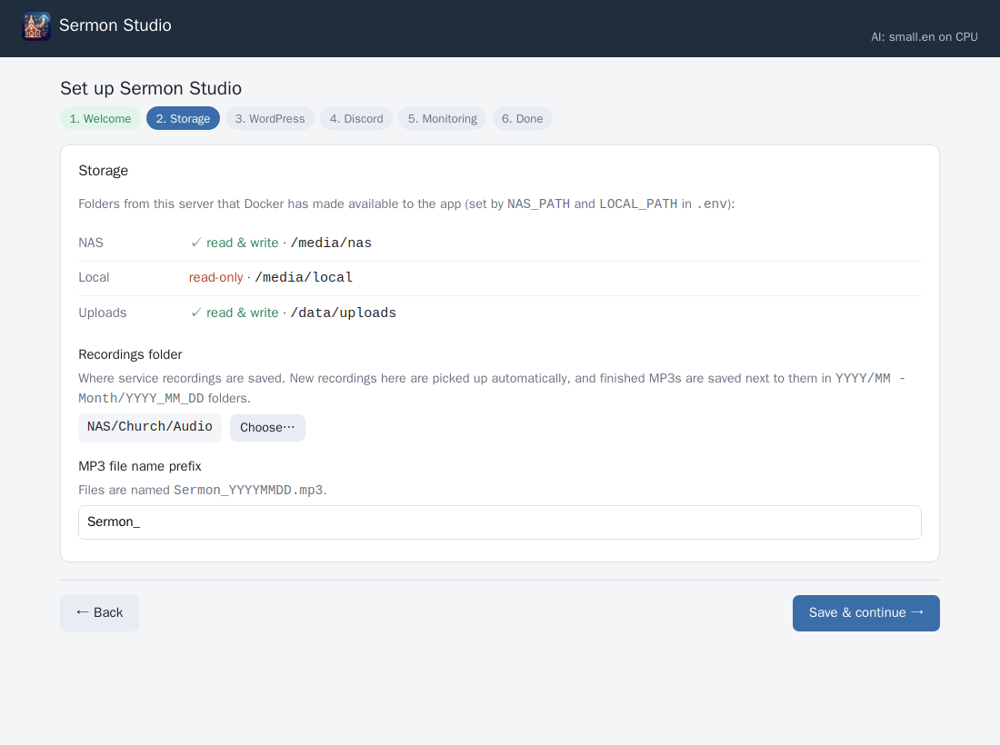

This folder matters in three ways:

1. When you upload a recording, the app suggests saving it here in a `YYYY/MM - Month/YYYY_MM_DD` folder. It copies the naming of folders that are already there, so if yours are named differently it follows those.
2. Finished MP3s and slides are saved next to their recording.
3. If you turn on monitoring (step 5), new recordings that appear here are processed automatically.

**MP3 file name prefix:** MP3s are named `<prefix>YYYYMMDD.mp3`, e.g. `Sermon_20261011.mp3`. Use whatever matches your existing files.

Press **Save & continue →**.

### Step 3 · WordPress

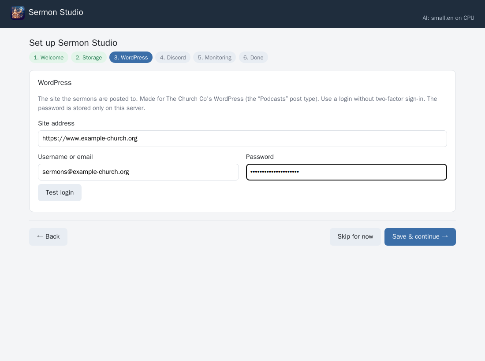

* **Site address:** your website, e.g. `https://www.your-church.org`
* **Username or email** and **Password:** a WordPress login that can create *Podcasts* posts and upload media.

When you press **Save & continue →**, the app logs in to check. If it works you'll see something like *"Logged in. Found 32 series and 7 speakers"*, and you move on.

Tips:

* **Use a dedicated account** with the *Editor* role (WP Admin → Users → Add New), so you can change or revoke it without touching your own login.
* **Two-factor sign-in or a captcha** on the login page will stop the app logging in. Use an account without them.
* The password is stored only on your server, in `data/settings.json`, which only the app's user can read. It's never shown in the browser again, and changing the site address clears it.
* Not ready yet? Press **Skip for now**. You can still make MP3s; uploading is switched on once a login is saved (⚙ Settings → WordPress).

### Step 4 · Discord bot (optional)

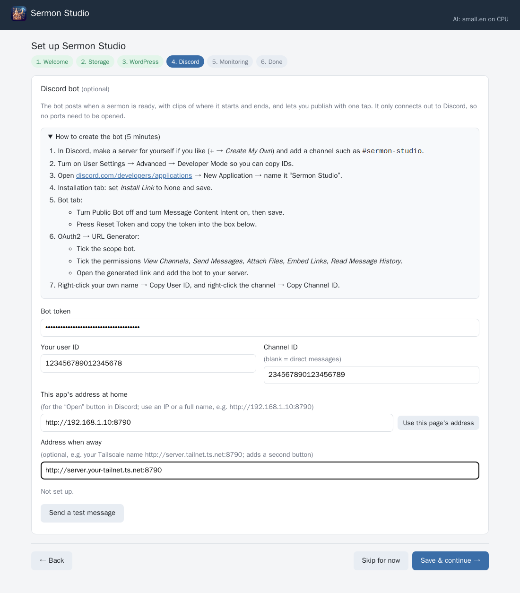

The bot messages you when a sermon has been analyzed. You get a 10-second clip of where it starts and where it ends, plus the title, speaker, series and description, with **Publish** and **Save as draft** buttons. It also asks you for the week's sermon slide. It only connects *out* to Discord, so you don't need to open any ports on your router.

Open **How to create the bot (5 minutes)** in the card. Step by step:

1. **A place for the messages.** In Discord, press **+** → *Create My Own* to make a server just for you, and add a text channel such as `#sermon-studio`. You can also skip this and get direct messages.
2. **Developer Mode.** **User Settings → Advanced → Developer Mode**, so you can copy IDs.
3. **Create the application.** Go to [discord.com/developers/applications](https://discord.com/developers/applications) → **New Application** → name it *Sermon Studio*.
4. **Installation tab.** Set **Install Link** to **None** and press *Save Changes*.
   *(If you skip this, Discord refuses the next step with "Private application cannot have a default authorization link".)*
5. **Bot tab.**
   * Turn **Public Bot** off.
   * Turn **Message Content Intent** on. The bot needs it to see the slide images you send.
   * Press *Save Changes*.
   * Press **Reset Token** and copy the token. Discord only shows it once; if you lose it, reset it again.
6. **OAuth2 → URL Generator.**
   * Tick the scope **bot**.
   * Tick the permissions **View Channels, Send Messages, Attach Files, Embed Links, Read Message History**.
   * Open the generated link at the bottom and add the bot to your server.
7. **Copy two IDs.** Right-click your own name → **Copy User ID**, and right-click the channel → **Copy Channel ID**.

Then fill in the card:

| Field | |
|---|---|
| **Bot token** | The token from step 5. Treat it like a password. |
| **Your user ID** | Only this Discord user can press Publish or send slides. |
| **Channel ID** | The channel to post in. Leave it blank for direct messages. |
| **This app's address at home** | For the *Open* button in the messages. Use an address with a dot in it, e.g. `http://192.168.1.10:8790`. Discord won't accept a bare name like `http://server:8790`. **Use this page's address** fills in what's in your browser's address bar. |
| **Address when away** (optional) | E.g. your [Tailscale](https://tailscale.com) name `http://server.your-tailnet.ts.net:8790`. Adds a second *Open* button that works from your phone away from home. |

Press **Save & continue →**. The app connects the bot and sends *"👋 Sermon Studio is connected"* to your channel. If something's wrong, the card says what, for example *"Discord rejected the bot token"* or *"Turn on Message Content Intent"*.

### Step 5 · Monitoring (optional)

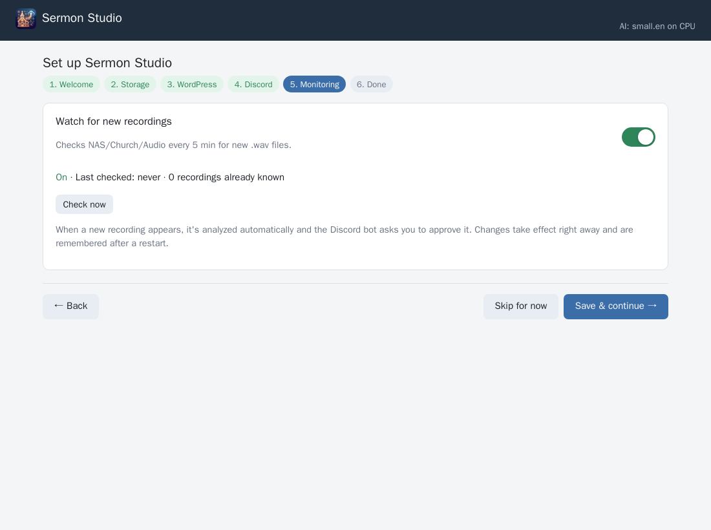

Turn on **Watch for new recordings** to have the app check the recordings folder every 5 minutes. When a new `.wav` appears and has finished copying, it's analyzed automatically and, if the Discord bot is set up, you get a message.

* **Existing recordings are ignored.** Only recordings added after you turn this on are processed. To process older ones, use the **⚡ Batch** tab later.
* **Not sure yet?** Leave it off. It's a single switch in ⚙ Settings at any time.

### Step 6 · Done

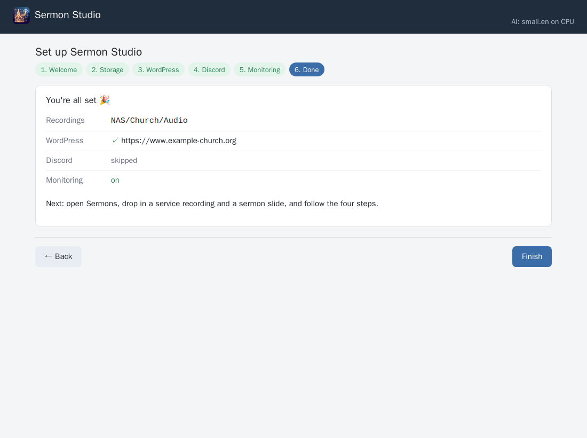

A summary of what's set up. Press **Finish**.

---

## Part 3 · After setup

You land on the **Sermons** tab:

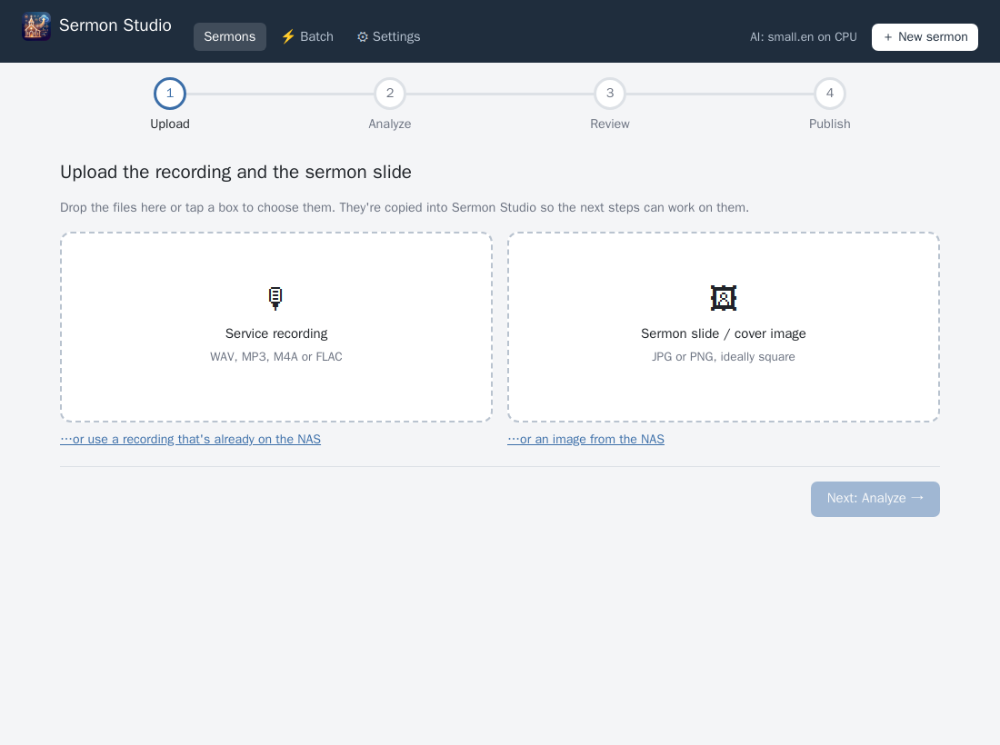

To make your first sermon:

1. **Upload:** drop the service recording and the sermon slide into the two boxes, then **Next: Analyze**.
2. **Save to the NAS?:** choose which files to keep next to the recording. Files already in that folder are switched off.
3. **Analyze:** transcription, finding the sermon by the preacher's voice, recognizing the preacher, and writing a title, scripture and short description. This takes about 20–30 minutes for a 70-minute service on a CPU, or a few minutes on a GPU. You can close the page while it works.
4. **Review:** check the start and end on the waveform and transcript, and the details.
5. **Publish:** make the MP3, then **Upload as draft** (recommended the first time; check it in WP Admin) or **Publish now**.

**Recognizing the preacher.** The app learns voices from the sermons you publish. The first time a preacher appears it can't know their name yet: it suggests your **default preacher** (⚙ Settings → *Default preacher*, chosen from your WordPress *People*), or last week's speaker if you haven't set one, and says so. Choose the right name before publishing, and from then on that voice is recognized.

Everything from the wizard can be changed later under **⚙ Settings**:

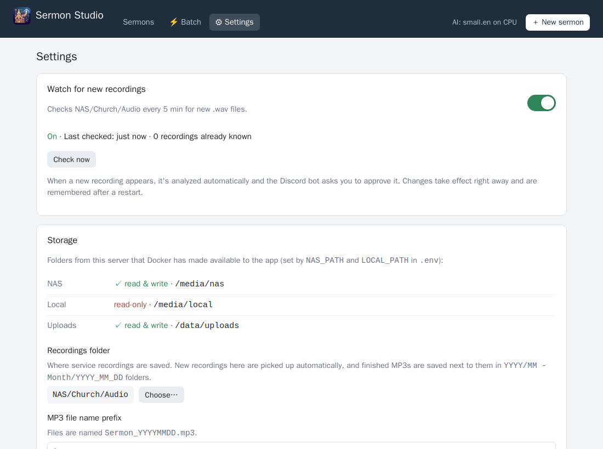

To run the wizard again: ⚙ Settings → *About* → **Run the setup wizard again**.

---

## Troubleshooting

| Problem | What to do |
|---|---|
| The page doesn't load | Is the container running? `docker compose ps`. Logs: `docker logs sermon-studio`, or `data/logs/sermon-studio.log`. |
| A folder shows **✗ missing** or **empty** | Check `NAS_PATH` / `LOCAL_PATH` in `.env` and that the share is mounted on the server, then `docker compose up -d`. |
| MP3s aren't saved to the NAS | The NAS folder must be writable by user ID 1000 (see 1.2). |
| WordPress: *"login failed: no session cookie"* | The account has two-factor sign-in, or the login page has a captcha. Use an account without them. |
| Discord: *"Discord rejected the bot token"* | Reset the token in the Developer Portal (Bot tab) and paste the new one. |
| Discord: messages arrive but slides are ignored | Turn on **Message Content Intent** (Bot tab), then save the Discord card again. |
| Discord: the *Open* button is missing | Use an address with a dot (an IP address or a full name) for *This app's address*. |
| Analysis is very slow | Without a GPU, a 70-minute service takes 20–30 minutes. Add an NVIDIA GPU and use `docker-compose.gpu.yml`. |
| Start/end not quite right | Fix it in the Review step. It works best when the preacher opens with a greeting ("good morning…", "open your Bibles…") right after the scripture reading or children's prayer. |

More detail on how everything works is in the main [README](../README.md).
